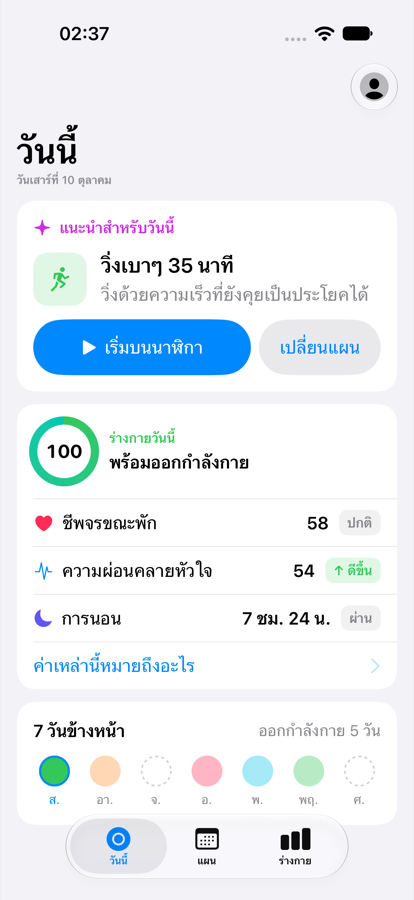
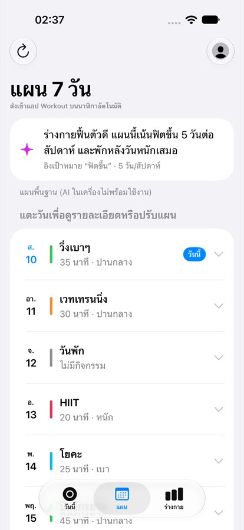
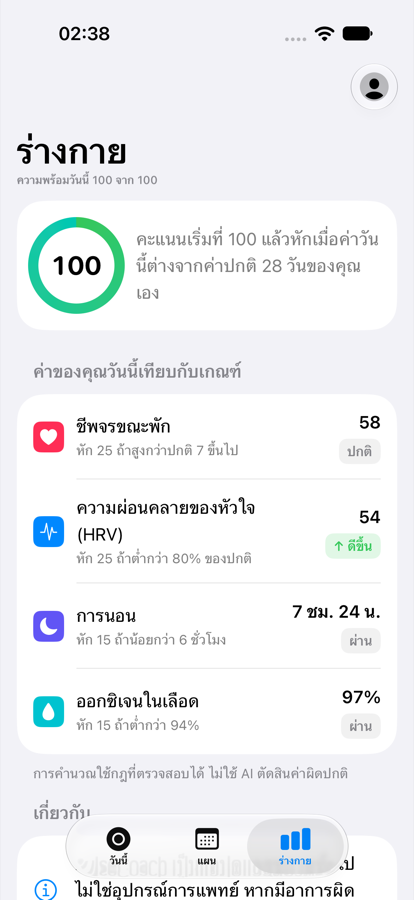
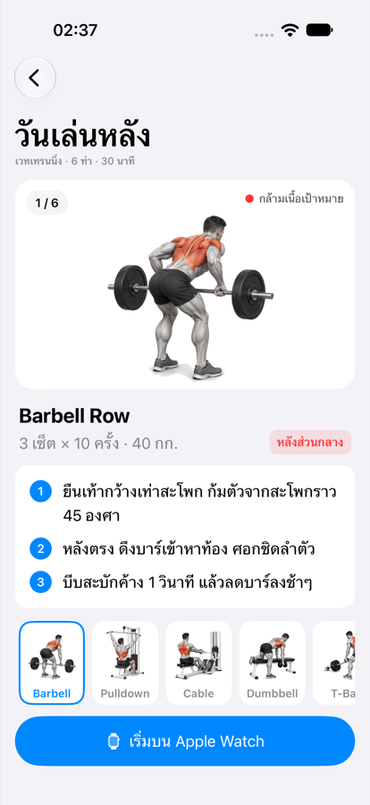
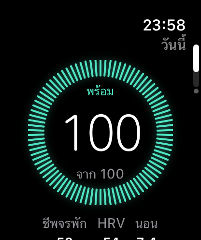
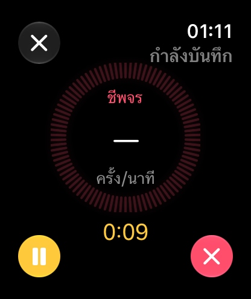
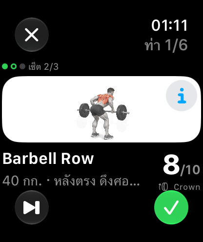
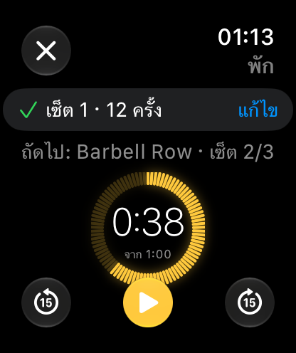

# PulseCoach

A readiness-based health coach for Apple Watch, with an iPhone companion app.

PulseCoach reads heart rate, HRV, sleep and blood oxygen from HealthKit, compares today against the user's own 28-day baseline, and answers one question each morning: *how ready am I to train today?* It then builds a safe 7-day training plan on-device and sends it to the Workout app on Apple Watch.


> PulseCoach is a wellness app, not a medical device. It never diagnoses anything and always points users to a doctor when something looks unusual.

## Screenshots

| Today | 7-day plan | Body | Gym guide |
| :---: | :---: | :---: | :---: |
|  |  |  |  |

| Readiness | Live workout | Exercise | Rest |
| :---: | :---: | :---: | :---: |
|  |  |  |  |

## Features

**iPhone**
- **Today** — a single recommendation for the day with one-tap start on the watch, plus resting heart rate, HRV and sleep shown against the user's own normal.
- **7-day plan** — generated on-device with Apple Foundation Models. Each day can be moved to tomorrow or made easier, with undo.
- **Body** — explains the score: every rule, the user's value today, and whether it passed.
- **Gym guide** — step-by-step exercise instructions with target muscles.
- **Onboarding** — goal, active days per week and preferred time shape the plan.

**Apple Watch**
- Readiness at a glance in a tick-ring display.
- Live workouts with heart rate and zone, saved to Health; ending always goes through a confirmation.
- Guided gym sessions: rep counting with the Digital Crown, rest timer, next-set preview.
- Readiness complication for the watch face.

**Across both**
- Health data stays on the user's devices. iPhone and watch sync directly through WatchConnectivity; nothing is sent to a server.
- Works without Apple Intelligence: a rule-based planner takes over when the on-device model is unavailable or slow.
- Thai-first copy, Dynamic Type and VoiceOver support, light and dark appearance.

## How it works

```text
 Apple Watch sensors ──► HealthKit ──► iPhone
                                        │  ReadinessEngine   (rules vs. 28-day baseline)
                                        │  FallbackPlanner   (on-device LLM → rule-based)
                                        │  SafetyValidator   (hard limits the plan must obey)
                                        ├──► WatchConnectivity ──► Watch app + complication
                                        └──► WorkoutKit ─────────► Workout app on the watch
```

A few decisions worth knowing about:

- **Readiness is rule-based, not AI.** Health signals have to be explainable and repeatable, so the score starts at 100 and deducts fixed amounts when today's values move away from the user's own baseline (median of the last 28 days). The same rules power the "Body" screen.
- **The LLM plans, the code decides.** The on-device model fills a typed `@Generable` structure, then `SafetyValidator` enforces the rules regardless of what the model returned: easy first day when readiness is low, no back-to-back hard days, at least one rest day.
- **No data is not good data.** If HealthKit returns nothing usable, the app says so and shows how to fix it rather than displaying a confident score.

## Project structure

```text
PulseCore/          Shared Swift package (no UI): models, readiness engine, planners, sync payload, HealthKit service
PulseCoach/         iOS app
PulseCoachWatch/    watchOS app
PulseWidgets/       watchOS complication (WidgetKit)
Shared/             Code and assets used by both apps (exercise images)
PulseCoachUITests/  iPhone UI tests
docs/               QA report and screenshots
scripts/            Tooling (UI regression runner)
project.yml         XcodeGen project definition
```

## Requirements

- macOS 26.6 or later with Xcode 27 (iOS 27 and watchOS 27 SDKs)
- [XcodeGen](https://github.com/yonaskolb/XcodeGen)
- A paid Apple Developer account to run on devices (HealthKit capability)
- For the full experience: an iPhone with Apple Intelligence and an Apple Watch on watchOS 27

## Getting started

```bash
brew install xcodegen
```

```bash
xcodegen generate
```

```bash
open PulseCoach.xcodeproj
```

Set your team in `project.yml` (`DEVELOPMENT_TEAM`) or under *Signing & Capabilities*, then run the **PulseCoach** scheme. The watch app is embedded and installs alongside it.

**Demo mode.** The simulator has no health sensors, so on the simulator the app starts with sample data. It can be switched off in *Profile → Devices & data*. The same switch is useful for App Review.

## Testing

Unit tests for the shared logic run on the Mac, no simulator needed:

```bash
cd PulseCore && swift test
```

UI tests drive the iPhone app end to end (onboarding, plan editing with undo, empty states, gym guide) and keep a screenshot of every step:

```bash
xcodebuild test -project PulseCoach.xcodeproj -scheme PulseCoach -destination 'platform=iOS Simulator,name=iPhone 18 Pro'
```

To run the suite on a specific device, appearance and text size and export the screenshots:

```bash
scripts/ui-regression.sh pro-light <simulator-udid> light
```

The latest results and the list of fixed and known issues are in [docs/QA-Report.md](docs/QA-Report.md).

## Status

Working on the simulator: all screens, plan generation (rule-based), plan editing, gym mode, complication, UI and unit tests.

Still to verify on real devices: HealthKit data, Foundation Models plans, iPhone–watch sync, WorkoutKit scheduling and notification delivery. See *Known issues* in the QA report for the rest of the backlog.
